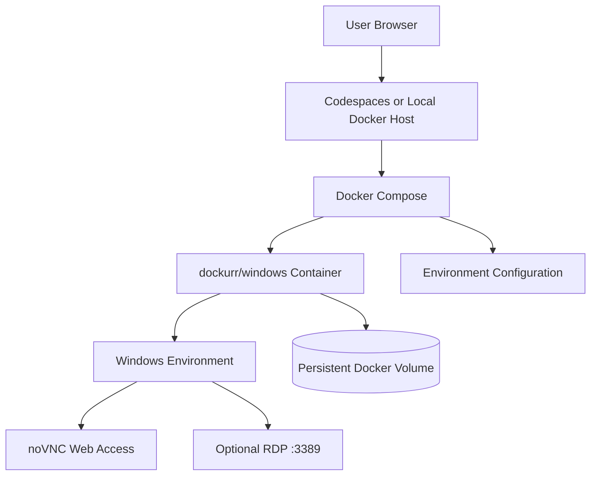

# PC-Free — Architecture

## High-level architecture

## Configuration
The README documents `windows10.yml`, environment variables for Windows credentials, version, RAM, CPU and disk size, and port mappings for web and RDP access.

## Persistence
The Compose file defines a named `windows-data` volume and a Docker data directory mapping. Persistence depends on retaining those volumes and the host/Codespaces storage.

## Security and operations
- Keep credentials out of tracked files.
- Review port visibility before exposing browser or RDP access.
- Do not run destructive volume cleanup unless intentionally deleting the Windows environment.
- Verify actual container image behavior and current upstream requirements before deployment.

## Not verified
No current runtime test, security audit, backup/restore test, or Windows licensing assessment is claimed by this page.