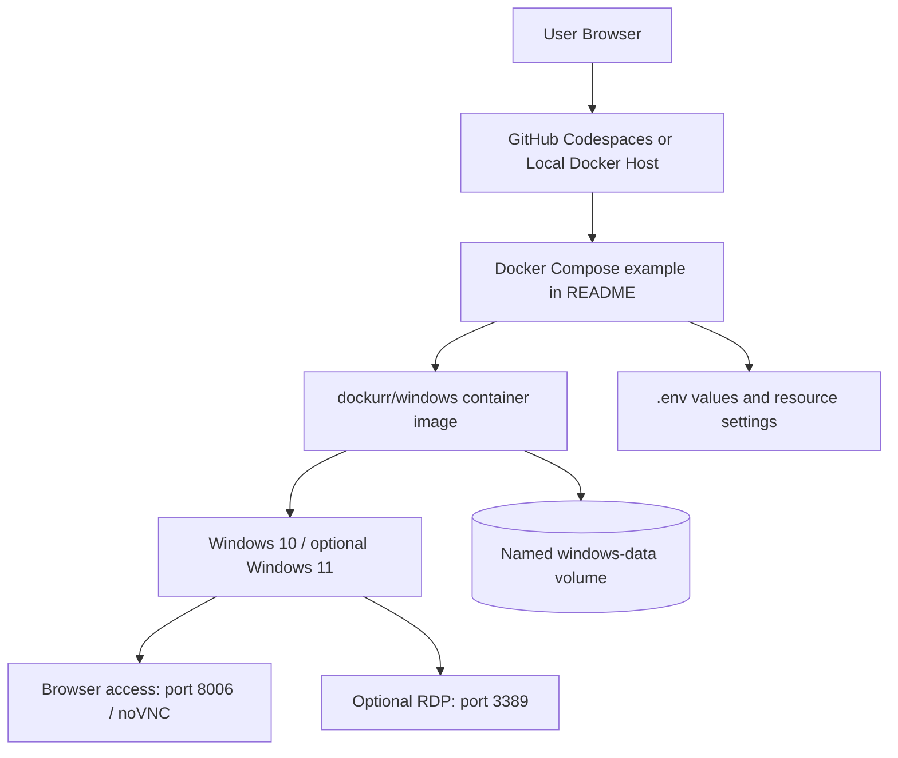

# PC-Free — Architecture

## Conceptual architecture from README

## Configuration documented in README
- Sample file name: `windows10.yml`.
- Container image: `dockurr/windows`.
- Environment: Windows version, username, password, RAM, CPU cores, and optional disk size.
- Ports: 8006 for browser access and 3389 for RDP.
- Storage: a named `windows-data` volume and a host data-root mapping.
- Linux virtualization devices shown in the example include `/dev/kvm` and `/dev/net/tun`.

## Verification status
The Compose definition appears as a code sample in README. Separate root Compose/config files were not found at the expected paths in this pass. The exact checked-in file tree, devcontainer setup, scripts, and CI pipeline still need inventory. The diagram is therefore a conceptual map of the README instructions, not a verified running deployment.

## Security and operations
- Keep credentials out of tracked source and verify that ignore rules actually cover `.env`.
- Review Codespaces port visibility before starting the service. The README contains both private-use framing and a troubleshooting instruction to set port 8006 Public; public exposure is not recommended without authentication and network controls.
- Do not run the `down -v` cleanup command unless intentionally deleting the Windows data volume.
- Verify backup and restore before relying on Docker volume persistence.

## Next source-inspection work
Inventory all tracked configuration and workflow files, identify the actual startup command and storage mounts, then replace README-only assumptions with file-backed documentation.